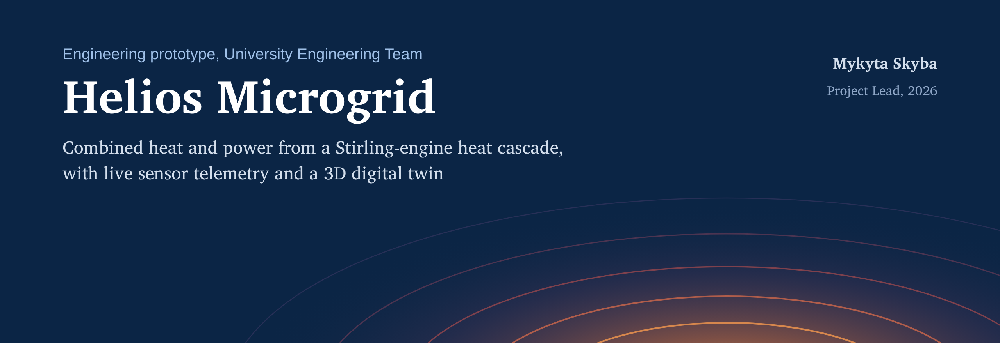
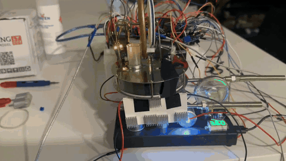
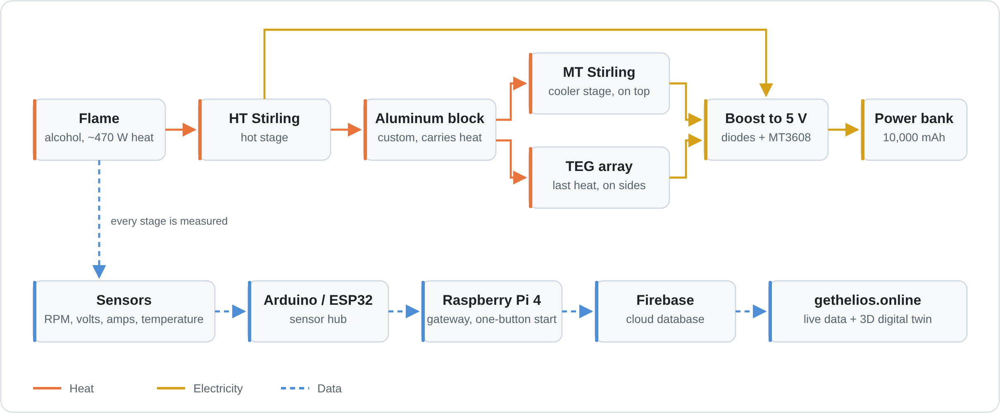
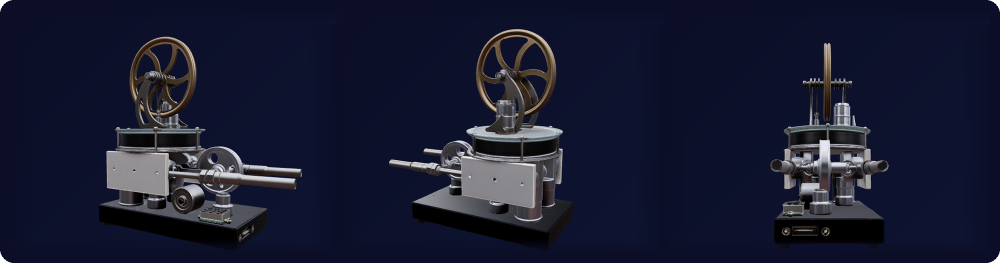
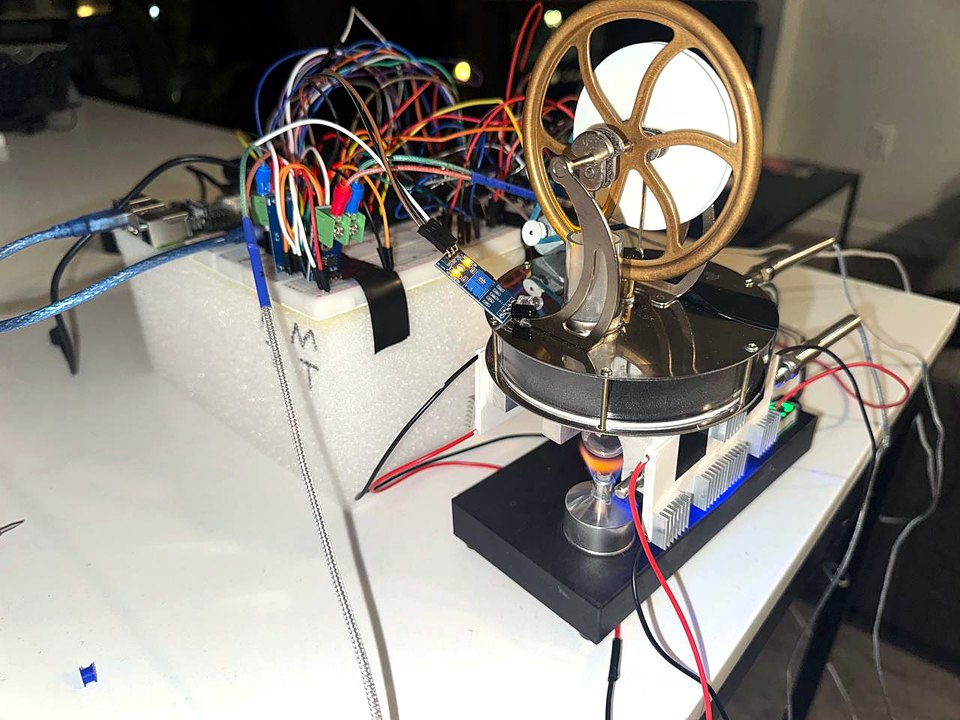
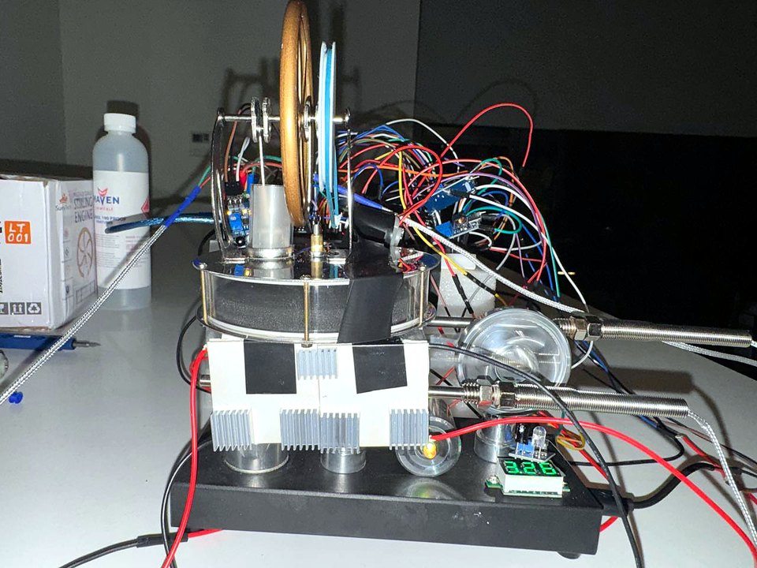
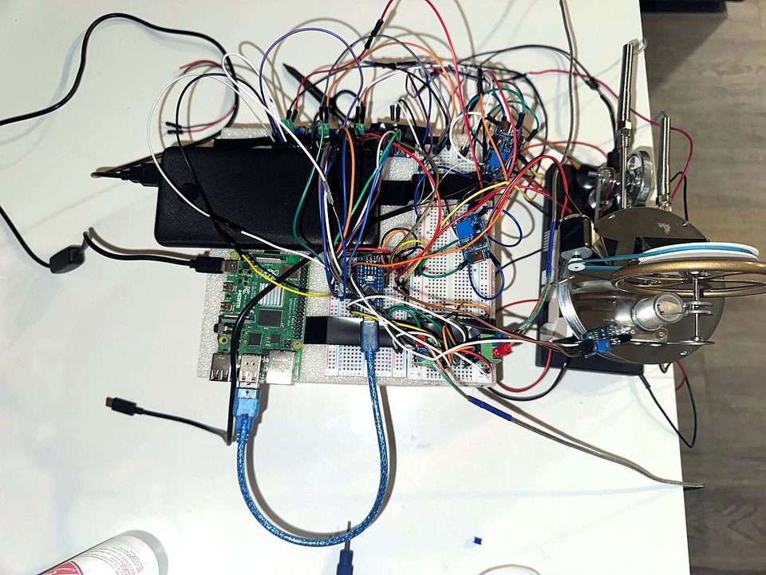

  &nbsp;
  &nbsp;
  

A tabletop power plant that tries to turn one flame into electricity three times, and sends every sensor reading to a live website with a 3D digital twin.

## The idea in 30 seconds

Most of the heat from a flame is simply lost. Helios tries to catch it in three steps, called a thermal cascade:

1. **Hot stage.** A Stirling engine sits over an alcohol flame and turns heat into motion. A small motor on its wheel makes electricity.
2. **Middle stage.** The leftover heat flows into an aluminum block we designed. A second, cooler Stirling engine sits on top of it.
3. **Last stage.** Thermoelectric generators (TEGs) on the sides of the block turn the remaining heat straight into electricity.

Sensors measure every stage. The readings go to the cloud and to a live website, where a 3D model of the station shows them.

The prototype running. The hot-stage engine spins over the flame while the sensor hub and the Raspberry Pi send data.

## How it works

<picture>
  <source media="(prefers-color-scheme: dark)" srcset="assets/helios-how-it-works-dark.png">
  
</picture>

The top row shows how heat becomes electricity. The bottom row shows how each stage is measured and put online.

## The 3D digital twin

The website has a full 3D model of the station that you can rotate in the browser.

## Plan versus measurement

The heat cascade and the data system worked. The mechanical power did not, and we measured exactly why.

| Stage | Plan | Measured | Why |
|---|---|---|---|
| Heat cascade | Heat reaches all three stages | Confirmed by the temperature sensors | Worked as designed |
| Hot-stage Stirling engine | 5 V × 10 mA, about 50 mW | 4.42 V × 4 mA, about 17.6 mW at peak | A hobby motor needs much more speed and torque than a small Stirling engine gives |
| Middle-stage Stirling engine | Drive a motor through 1:5 gearing | Stalled, 0 V | The gearing cut the torque below the motor's own resistance |
| TEG array | Turn the last heat into electricity | 0.17 V, about 34 µW at peak | Small passive heatsinks warmed up, so the temperature difference disappeared |
| Data system | Sensors to website, started by one button | Worked | Live telemetry and the digital twin ran as planned |

The flame gave about 470 W of heat, so the overall efficiency was about 0.0037%. The [engineering analysis](docs/README.md) has the full calculations, the CAD model and the thermal simulation.

## What I learned

- Test the mechanics before building around them. Torque, not only speed, decides whether a small engine can drive a generator.
- TEGs need a real temperature difference, which means active cooling (a fan or water) instead of small heatsinks.
- The next version would use engines designed from scratch and a custom PCB instead of breadboards.

## Inside the build

<table>
  <tr>
    <td width="33%"></td>
    <td width="33%"></td>
    <td width="33%"></td>
  </tr>
  <tr>
    <td align="center">The full setup</td>
    <td align="center">Hot-stage engine, aluminum block and TEGs</td>
    <td align="center">Sensor hub and Raspberry Pi 4</td>
  </tr>
</table>

## Team

Built by the [University Engineering Team](https://www.linkedin.com/in/uet-university-engineering-team-aa9005392), with members in Washington, DC and Poland.

| Name | Role |
|---|---|
| [Mykyta Skyba](https://www.linkedin.com/in/m-skyba) | Project Lead: system design, integration and the thermal analysis |
| [David Matsievich](https://www.linkedin.com/in/david-matsievich-44ba97235/) | Assistant Project Lead: middle-stage engine and structure |
| [Andrii Serdiuk](https://www.linkedin.com/in/andriiserdiukk/) | IT and DevOps: cloud and deployment |
| [Marcel Marek](https://www.linkedin.com/in/marcelmarek/) | AI: digital twin integration |
| [Szymon Pankiewicz](https://www.linkedin.com/in/szymon-pankiewicz/) | Design: visual identity and UI |
| [Michał Dąbrowski](https://www.linkedin.com/in/michal-dabrowski03/) | Quality assurance and documentation |
| [Simon Rakhlin](https://www.linkedin.com/in/simon-rakhlin/) | Finance: 5-year financial model and LCOE |
| [Andrey Berks](https://www.linkedin.com/in/andreyberks/) | Quantitative analysis: token model |
| [Ava Amelio](https://www.linkedin.com/in/ava-amelio-b2ab09357/) | Policy research: large-scale production |

## What is in this repository

| Folder | What is inside |
|---|---|
| [docs/](docs/) | Engineering analysis: efficiency, gearing, thermal simulation and telemetry |
| [hardware/](hardware/) | Schematic, wiring and the bill of materials |
| [software_engineering/](software_engineering/) | Sensor firmware (Arduino) and the Raspberry Pi data script |
| [website/](website/) | The React website with live data and the 3D digital twin |
| [fintech_and_business/](fintech_and_business/) | The 5-year financial model (LCOE) and the token concept |

<b>Bill of materials, about $424</b>

| Group | Parts | Cost |
|---|---|---|
| Thermal core | Hot-stage Stirling engine (Sunnytech SC02M) $59.99, middle-stage Stirling engine (Sunnytech LT001) $39.99, TEGs (5-pack) $17.75, denatured alcohol $16.99, heatsinks $8.99, thermal paste $5.99 | $149.70 |
| Electrical | Anker power bank 10,000 mAh $25.99, MT3608 boost converters $5.99, type-130 DC motors $6.99, 1N5817 Schottky diodes $5.99, breadboard and wires $19.99 | $64.95 |
| Data and compute | ESP32 and Arduino Nano $9.99, INA219 voltage and current sensor $8.99, K-type thermocouples $7.69, MAX6675 modules $8.00, IR RPM sensors $6.99, Raspberry Pi 4 (4 GB) $60.00 | $101.66 |
| Other | PLA filament $19.99, plus structural materials and wiring | the rest |

